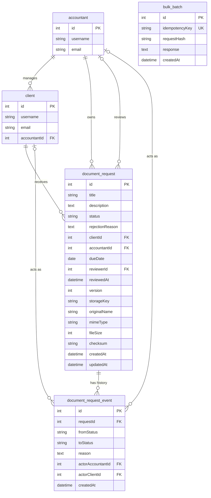

## 1. Overview and goals
 
This document describes the database design, and the decisions behind it, for the Requests Portal feature, using MariaDB. It is sized for the scenario in the brief: about 1,000,000 requests, 200 accountants and 20,000 clients.
 
The design focuses on four things:
 
- correct, concurrency-safe status transitions
- indexes chosen for the most used queries
- measured performance
- trade-offs, written down together with what each choice gives up

## 2. ERD
 

 
Table names are snake_case and column names are camelCase, because TypeORM maps entity properties to column names as written.
 
Every event has exactly one actor: exactly one of `actorAccountantId` and `actorClientId` is set, enforced by a `CHECK` constraint in the migration. A newly created request has `fromStatus` NULL.
 
The relations are required in the database, not only in the code: `document_request.clientId` and `client.accountantId` are `NOT NULL`, so a request cannot exist without a client and a client cannot exist without an accountant.
 
## 3. Schema changes and why each column exists
 
| Column | Table | Why |
| --- | --- | --- |
| `accountantId` | `document_request` | Copied from the client so the inbox filter and the inbox indexes (section 5) need no join. Trade-off: the same fact is stored twice. Rule: it is the owner at creation time, and clients do not change accountant. |
| `dueDate` | `document_request` | Needed for the overdue filter and the dashboard. |
| `reviewerId` | `document_request` | Who made the current decision. Empty until a decision. |
| `reviewedAt` | `document_request` | When the approve or reject decision was made. |
| `version` | `document_request` | Optimistic locking: detects that the row changed since it was read, for example a re-upload while the status is still `reviewing`. |
| `storageKey`, `originalName`, `mimeType`, `fileSize`, `checksum` | `document_request` | Replace `documentPath`, so the API never exposes a server path and the file is described properly. |
| `description` | `document_request` | Widened from `varchar(255)` to `text`. |
| `document_request_event` | new table | Append-only log of every change: who, from what, to what, when and why. Gives the history endpoint, every rejection reason, and the review turnaround for the dashboard. |
| `bulk_batch` | new table | Stores the idempotency key of a bulk create, so a retry cannot create the batch twice. |
 
The brief's example event table has a single `actor_id`. Here it is two columns, `actorAccountantId` and `actorClientId`, with a `CHECK` that exactly one is set. Accountants and clients are different tables, and a foreign key can only point at one table, so this keeps real foreign keys without merging them into a single `user` table, which is listed as a later change in section 9.
 
## 4. Actor assumption
 
The server identifies the actor from an `X-Actor-Id` header. It checks that the user exists and that their role fits the action (an accountant creates, reviews, approves and rejects requests; a client uploads), and it records the id in the event row so the history shows who acted.
 
The weakness is that this is identification, not authentication: anyone can claim to be any actor, and the server cannot verify that the caller really is that user.
 
I would use JWT bearer tokens in production. A guard verifies the signature and expiry, rejects a missing or invalid token with 401, and rejects a valid user with the wrong role with 403.
 
## 5. Indexes

Each index is derived from a real query, and was checked at 1,000,000 rows with `EXPLAIN`, `ANALYZE` and a load test (`docs/PERFORMANCE.md`). The write cost column says which operations touch it. In InnoDB every secondary index entry also stores the primary key, so `id` at the end of an index makes the tie-breaker explicit and costs nothing extra.

| Query | Index | Why this order | Write cost |
| --- | --- | --- | --- |
| Inbox, newest first, with no status filter or several statuses: `WHERE accountantId = ? ORDER BY createdAt DESC, id DESC`. Also the keyset cursor and the overdue filter. | `IDX_request_inbox_created` `(accountantId, createdAt, id)` on `document_request` | The equality column opens the accountant's folder, and the index stores that accountant's requests already in the order of the `ORDER BY`, so the newest rows are read from the end and nothing is sorted. Status and due date filters are checked on the rows read. It also serves the foreign key on `accountantId`. | One entry per insert. The indexed columns never change, so a status change does not touch it. |
| Inbox, one status: `WHERE accountantId = ? AND status = ? ORDER BY createdAt DESC, id DESC` | `IDX_request_inbox_status_created` `(accountantId, status, createdAt, id)` on `document_request` | Two equality columns open the accountant and status folders, and `createdAt` gives the order inside, so exactly the 21 rows needed are read. Without it, a status filter reads rows in date order and fetches each one to check its status. Through its leftmost prefix it also serves the dashboard counts per status. | One entry per insert. It moves whenever `status` changes, so every review and upload touches it. |
| Inbox sorted by due date: `WHERE accountantId = ? AND dueDate IS NOT NULL ORDER BY dueDate ASC, id ASC` | `IDX_request_inbox_due` `(accountantId, dueDate, id)` on `document_request` | The same rule for the other sort: the order is in the index, so there is no sort over thousands of entries. `IS NOT NULL` becomes an index range that skips requests without a due date. | One entry per insert. It moves only when `dueDate` changes. |
| Dashboard: the overdue count and the top clients: `WHERE accountantId = ? AND status IN (...)` with the due date or the client | `IDX_request_dashboard` `(accountantId, status, dueDate, clientId)` on `document_request` | Both queries filter on the accountant and the status, and then need the due date or the client. With those columns in the index, they are answered from the index alone, without reading table rows. | One entry per insert. It moves when `status` or `dueDate` changes. |
| History: `WHERE requestId = ? ORDER BY createdAt, id` | `IDX_event_request_history` `(requestId, createdAt, id)` on `document_request_event` | `requestId` is the only equality, so it opens the folder. `createdAt` then `id` give the order, with `id` as the tie-breaker for equal timestamps. It also serves the foreign key on `requestId`. | Events are only inserted, never updated or deleted, so one entry per insert. |
| Idempotency: `WHERE idempotencyKey = ?` | `UQ_bulk_batch_key` (unique) on `bulk_batch` | A unique index makes the duplicate check atomic: two retries at once cannot both insert. | One entry per batch. |
| Foreign key on the reviewer | `IDX_request_reviewer` `(reviewerId)` on `document_request` | MariaDB needs an index on every foreign key column. It is created explicitly so it is named and dropped by the migration. | `reviewerId` is set once, at the decision. |

**The rule behind the three inbox indexes.** An index serves a query when its columns are in the order of the query: first the columns filtered by equality, then the columns in the `ORDER BY`. A column in the middle that the query does not filter on breaks the order, and the database has to gather and sort rows instead of reading the newest ones.

**Revision after measurement.** The first design used `(accountantId, status, createdAt)` and `(accountantId, status, dueDate)`. These give date order only when one status is selected. At 1,000,000 requests the default view and the due date sort have no status filter, so the database had to gather and sort the accountant's rows (8,790 rows sorted to return 21, and the sort was 96% of the query's time). Under 20 concurrent users the optimizer also chose the index without `createdAt` for many accountants, which forced about 13,800 page reads per query instead of 91. I replaced both indexes with ones that hold the order columns, and added a separate index for a single status. Inbox p95 at 20 concurrent users went from 1.24 s to 31 ms for the default view, from 371 ms to 37 ms for a single status, and from 1.49 s to 40 ms for the due date sort. Several statuses (37 ms) and overdue (45 ms) are served by the first index without a merge or a sort: it reads in date order and checks each row (43 rows read to find 21 for two statuses). The trade-off is the write cost of three inbox indexes, measured in section 6 of `docs/PERFORMANCE.md`, and that a status filter on a very rare status would read many rows through the first index. Every status in this dataset is between 15% and 40%, so the status index covers that case directly.

**Dashboard.** One covering index, `IDX_request_dashboard`, was added after measuring the live dashboard at 1,000,000 rows (see `docs/PERFORMANCE.md`). The turnaround query reads the event table through its history index.
 
## 6. Concurrency design
 
### The problem
 
Reviewing a request reads the row, checks the status in code, and then writes the result. Those are three separate steps, and another request can slip in between them. That causes two problems:
 
- Two accountants approve and reject the same request at the same moment. Both pass the check, and the last write silently overwrites the first.
- A reviewer opens a request, the client re-uploads a corrected file, and the reviewer approves a file they never saw. The status is still `reviewing`, so a status check does not notice.

A stricter check in the code cannot fix this, because the gap between the check and the write still exists.
 
### Options considered
 
1. **Conditional update.** Put the check in the write: `UPDATE ... WHERE id = ? AND status = 'reviewing'`. It is atomic, simple, and needs no extra column. Its downside is that it only protects the condition written in the `WHERE`, so it misses other changes, such as a re-upload while the status stays `reviewing`.
2. **Row lock (pessimistic).** Read inside a transaction with `SELECT ... FOR UPDATE`, which blocks anyone else touching that one row until the transaction ends. It is always correct. Its downsides are that the lock is held for the whole transaction, it holds a database connection, it cannot span the time a person spends reading a document, and locking several rows in different orders can deadlock.
3. **Version column (optimistic).** Each row carries a counter that increases on every write. The update only succeeds if the version still matches the one the client read. It takes no lock, and it detects any change to the row. Its costs are one extra column, the client must send back the version it saw, and every write path must bump it.

### Choice
 
I chose the version column, for these reasons:
 
- A reviewer reads for an unpredictable time, so a row lock cannot cover the gap between reading and clicking. A version travels with the click.
- Collisions on a single request are rare, so optimistic locking costs almost nothing in the normal case, and fails safely with a 409 in the rare one.
- It catches the re-upload case that a status-only check misses.
- It does not replace history. The append-only `document_request_event` table records who changed what and when.

For a short automated operation with no human in the middle, a conditional update would also be fine.
 
### How it works
 
Every response that returns a request includes its `version`. The review request must send back the version the reviewer saw. In one transaction, the server:
 
1. Runs `UPDATE document_request SET status = ?, rejectionReason = ?, reviewerId = ?, reviewedAt = ?, version = version + 1 WHERE id = ? AND version = ? AND status = 'reviewing'`.
2. If one row changed, inserts the matching `document_request_event` row (from status, to status, actor, reason).
3. If zero rows changed, rolls back and returns `409 Conflict`, because someone changed the request first.

The upload path follows the same pattern and also bumps `version`. If it did not, a re-upload would go undetected.
 
### Isolation level

The review and upload transactions run at READ COMMITTED. Under MariaDB's default REPEATABLE READ, a request that lost a race read the row again from a snapshot taken before the winner committed, so it saw the old version, concluded that the status was wrong, and answered 400 instead of 409. The conditional `UPDATE` already prevented any double write, because an `UPDATE` always sees the latest data: only the error code was wrong. READ COMMITTED makes every statement in the transaction see the latest committed data. The parallel integration test found this.

### How it is proven
 
An integration test against a real MariaDB (`test/integration/requests.int-spec.ts`, also run in CI against a MariaDB service) sends 20 parallel approve and reject calls for the same request. Exactly one returns 200, the other 19 return 409, and the request's event history shows one consistent transition.
 
## 7. Trade-offs
 
### Keyset vs offset pagination
 
- **Question:** how the inbox (`GET /requests`) returns its pages at about 1,000,000 rows.
- **Options:** Offset (`LIMIT 20 OFFSET n`) makes the database count past every skipped row, so deep pages get slower, and rows inserted while a user is paging can shift the pages so a row repeats or is skipped. Keyset uses a bookmark (the last row seen) and the index jumps straight to it, so any page costs about the same.
- **Choice:** keyset on `(createdAt, id)`. The `id` is the tie-breaker, so the bookmark points at exactly one row. The server fetches `limit + 1` rows to know whether a next page exists.
- **What I give up:** jumping to page N and page numbers. The client only gets next and previous. Each sort order (created date, due date) needs its own index and its own cursor.

### Total count
 
- **Question:** whether the inbox should return the total number of matching requests with each page.
- **Options:** return a total on every page; never return one; or return it only when asked. A total means the database must find and count every matching row on each request, so the cost grows with the number of matches, and `limit + 1` cannot replace it because it only says whether a next page exists.
- **Choice:** no total on the inbox. The response carries the next cursor, and the dashboard already gives counts per status when a number is needed.
- **What I give up:** the UI cannot show "page 3 of 62" or "1,243 results" from the inbox itself.

### Denormalising accountantId
 
- **Question:** should each request store its own `accountantId`, or find the accountant by going through the client?
- **Options:** Without the copy, the inbox has to find the accountant's clients, collect their requests and sort the combined result, because an index can only sort one client's requests at a time. With the copy, one index finds all of an accountant's requests already sorted.
- **Choice:** copy `accountantId` onto the request, so the inbox is a single index lookup with no join and no sort.
- **What I give up:** the same fact is stored in two places and could disagree. If a client moved to another accountant, old requests would still show the old one. The rule that manages this: the value is set once, when the request is created, from the client's accountant, and it means the owner at creation time. Clients do not change accountant in this take-home.

### Dashboard: live aggregation vs rollup table
 
- **Question:** how the accountant dashboard (`GET /accountants/:id/dashboard`) produces its numbers, and how stale they may be.
- **Options:** live aggregation (run the queries on every load); a rollup table (precomputed numbers per accountant, updated with each status change or by a job); or a short-lived cache of the live result.
- **Choice:** build the live version first and measure it against the target (p95 under 300 ms at 20 concurrent users on 1,000,000 rows). If it misses, add a short cache of about 30 seconds first, because it adds no cost to writes and cannot drift from the data. A rollup table only if the cache is not enough.
- **Staleness:** live numbers are exact. Cached numbers can be up to 30 seconds old, which is acceptable because the dashboard is an overview, and the inbox is where exact data matters.
- **Measured:** the live version missed the target (p95 2.56 s). With the cache, p95 is 3 ms. A larger InnoDB buffer pool (1 GB instead of the default 128 MB) also brought the live version to p95 186 ms, so a cache miss costs about 0.2 s instead of about 3 s. A covering index for its two heaviest queries then brought the live version to p95 139 ms (`docs/PERFORMANCE.md`).
- **What I give up:** with a cache, numbers up to 30 seconds old, and an in-memory cache is per application instance, so several instances would need a shared cache. A rollup would instead make every status change slower and add a risk of drift.

## 8. Migrations plan
 
`synchronize` is turned off. Schema changes are made only through migrations, each with an `up` and a `down`, and database credentials come from `.env`. With `synchronize: true` nobody reviews a schema change, there is no history and no way back, and a column rename can be applied as drop-and-add, which loses the column's data.
 
| # | Up | Down |
| --- | --- | --- |
| 0 | Create the original schema: `accountant`, `client` and `document_request` (with `documentPath`), including the foreign keys. `client.accountantId` and `document_request.clientId` are `NOT NULL`. | Drop the foreign keys, then the three tables. |
| 1 | In one `ALTER TABLE` (`ALGORITHM=INSTANT`), add `dueDate`, `reviewerId`, `reviewedAt`, `storageKey`, `originalName`, `mimeType`, `fileSize`, `checksum`, `version` (default 0) and `accountantId` as nullable. Widen `description` to text. | Restore `description` to `varchar(255)` and drop the ten added columns. |
| 2 | Backfill `accountantId` from each request's client. Copy `documentPath` into `storageKey`. | Nothing. The copied data is derived, and the `down` of step 1 drops the columns. |
| 3 | Make `accountantId` `NOT NULL`. Create the two inbox indexes and the `reviewerId` index. Then add the foreign keys on `accountantId` and `reviewerId`. | Drop the foreign keys, then the indexes, then make `accountantId` nullable again. |
| 4 | Create `document_request_event` (foreign keys, a `CHECK` that exactly one actor column is set, and the history index) and `bulk_batch` (unique `idempotencyKey`). | Drop `bulk_batch`, then `document_request_event`. |
| 5 | Drop `documentPath`. | Re-add `documentPath` and copy the values back from `storageKey`. |
| 6 | In one `ALTER TABLE`: replace `IDX_request_inbox_created` with `(accountantId, createdAt, id)`, add `IDX_request_inbox_status_created` `(accountantId, status, createdAt, id)`, and replace `IDX_request_inbox_due` with `(accountantId, dueDate, id)`. Written after measuring the first design at 1,000,000 rows (section 5). | Restore the original `(accountantId, status, createdAt)` and `(accountantId, status, dueDate)` definitions and drop the status index. |
| 7 | Add `IDX_request_dashboard` `(accountantId, status, dueDate, clientId)`, after measuring the dashboard queries at 1,000,000 rows (section 5). | Drop the index. |
 
**Order of the indexes and the foreign keys.** The indexes are created before the foreign keys on purpose. MariaDB needs an index on every foreign key column and creates one silently when none exists. Creating the inbox index first lets the `accountantId` foreign key reuse it, so there is no redundant index to pay write cost for. The history index on the event table does the same for its `requestId` foreign key. Migration 6 keeps that guarantee: it replaces the inbox indexes in a single `ALTER TABLE`, so the foreign key on `accountantId` always has an index, and its `DROP INDEX IF EXISTS` for the status index makes it safe on a database where that index was created by hand while experimenting.
 
Migration 0 exists so that a clean database can be built from migrations alone, because `synchronize` is off. It is not run against an existing development database; that database is recreated instead.
 
The data is filled (step 2) before it is enforced (step 3), and the old column is dropped last (step 5). On a large table the backfill runs in batches. In MariaDB, schema changes commit implicitly and cannot be rolled back inside a transaction, so each migration is kept small.
 
Each migration is verified by running `up`, then `down`, then `up` again, with test rows inserted before the backfill. The whole chain was also run from an empty database with `docker compose down -v`, then `migration:run`. After the index changes, `migration:generate` was run as a drift check: it reports only the foreign key names (the migrations use readable names, TypeORM would generate hashed ones, and `RESTRICT` and `NO ACTION` behave the same in MariaDB).
 
## 9. What I would change at 100M rows
 
The event table is the largest table: each request creates several events, so 100M requests means roughly 300M to 500M events. These are the changes I would make.
 
- **Partition the event table by month** (`createdAt`) and archive old partitions, instead of moving rows with a job, because deleting hundreds of millions of rows is slow. The cost is that MariaDB partitioned tables do not support foreign keys, so integrity moves into the application, and the history endpoint must also reach archived data.
- **Archive old closed requests** the same way. The inbox mostly touches open and recent requests.
- **Dashboard:** if the number of requests per accountant grows, move from live aggregation and a cache to a rollup table, accepting the extra write cost.
- **Review the indexes.** Each index costs write time and memory, and at this size the indexes no longer fit in memory, so drop unused ones.
- **Online schema changes:** run large backfills in batches, or with an online schema-change tool.
- **Read replica** for dashboard and history reads.
- **Files:** a child table with one row per upload (several documents per request and kept file history), and object storage instead of local disk.
- **Users:** a single `user` table instead of separate accountant and client tables.
- **Ids:** time-ordered UUIDs (for example v7) instead of auto-increment integers, for unguessable ids and ids that can be generated before the insert. The cost is larger indexes, because every index entry stores the primary key, so I would measure index size and insert cost first.
- **Authentication:** JWT in place of the actor header.

## 10. Assumptions and what was cut
 
- **Who may review.** `accountantId` is the owning accountant and drives the inbox. Any accountant may review any request, for example a colleague covering, and `reviewerId` records who actually decided. An owner-only check is a production hardening step that belongs with real authentication. The version column is needed regardless, because the same accountant can act from two tabs and a client can re-upload while a request is being reviewed.
- **Open, overdue and outstanding.** A request is open while its status is `pending` or `reviewing`. It is overdue when it is open and its `dueDate` has passed. Outstanding means open. Finished requests (approved or rejected) are never overdue, even if the decision came after the due date.
- **Idempotency key for bulk create.** The client sends a unique key (a UUID it generates) in the `Idempotency-Key` header of each bulk request. The server stores it in a small `bulk_batch` table, with a hash of the request body and the response, in the same transaction that creates the requests. The key is unique, so a retry, or two retries at once, cannot create a second batch: the server finds the existing key and returns the stored response. The same key with a different body is rejected. The key belongs to the batch, so the large table needs no extra column or index. Old keys are deleted after a retention period, for example 24 hours.