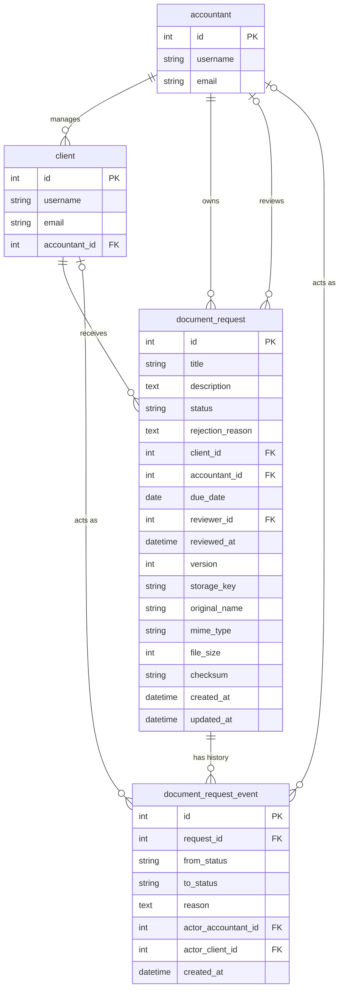

# Design: Requests Portal at scale

## 1. Overview and goals

This document describes the database design, and the decisions behind it, for the Requests Portal feature, using MariaDB. It is sized for the scenario in the brief: about 1,000,000 requests, 200 accountants and 20,000 clients.

The design focuses on four things:

- correct, concurrency-safe status transitions
- indexes chosen for the most used queries
- measured performance
- trade-offs, written down together with what each choice gives up

## 2. ERD

Every event has exactly one actor: exactly one of `actor_accountant_id` and `actor_client_id` is set, enforced by a `CHECK` constraint in the migration. A newly created request has `from_status` NULL.

## 3. Schema changes and why each column exists

| Column | Table | Why |
| --- | --- | --- |
| `accountant_id` | `document_request` | Copied from the client so the inbox filter and the index `(accountant_id, status, created_at)` need no join. Trade-off: the same fact is stored twice. Rule: it is the owner at creation time, and clients do not change accountant. |
| `due_date` | `document_request` | Needed for the overdue filter and the dashboard. |
| `reviewer_id` | `document_request` | Who made the current decision. Empty until a decision. |
| `reviewed_at` | `document_request` | When the approve or reject decision was made. |
| `version` | `document_request` | Optimistic locking: detects that the row changed since it was read, for example a re-upload while the status is still `reviewing`. |
| `storage_key`, `original_name`, `mime_type`, `file_size`, `checksum` | `document_request` | Replace `documentPath`, so the API never exposes a server path and the file is described properly. |
| `document_request_event` | new table | Append-only log of every change: who, from what, to what, when and why. Gives the history endpoint, every rejection reason, and the review turnaround for the dashboard. |

## 4. Actor assumption

The server identifies the actor from an `X-Actor-Id` header. It checks that the user exists and that their role fits the action (an accountant creates, reviews, approves and rejects requests; a client uploads), and it records the id in the event row so the history shows who acted.

The weakness is that this is identification, not authentication: anyone can claim to be any actor, and the server cannot verify that the caller really is that user.

I would use JWT bearer tokens in production. A guard verifies the signature and expiry, rejects a missing or invalid token with 401, and rejects a valid user with the wrong role with 403.

## 5. Indexes

Each index is derived from a real query. The write cost column says which operations touch it.

| Query | Index | Why this order | Write cost |
| --- | --- | --- | --- |
| Inbox, newest first: `WHERE accountant_id = ? AND status IN (...) ORDER BY created_at DESC, id DESC` | `(accountant_id, status, created_at)` on `document_request` | The equality columns open the accountant and status folders, and `created_at` last gives the order inside them, so no sort is needed when one status is selected. It also serves the dashboard counts through its leftmost prefix. | Every insert adds one entry. A status change moves the entry. `created_at` never changes. |
| Inbox, by due date: `WHERE accountant_id = ? AND status = ? ORDER BY due_date ASC`, and the overdue filter | `(accountant_id, status, due_date)` on `document_request` | Same folders, with `due_date` last as the order, and as the range for the overdue filter. | Every insert adds one entry. It moves when `status` or `due_date` changes. |
| History: `WHERE request_id = ? ORDER BY created_at, id` | `(request_id, created_at, id)` on `document_request_event` | `request_id` is the only equality, so it opens the folder. `created_at` then `id` give the order, with `id` as the tie-breaker for equal timestamps. | Events are only inserted, never updated or deleted, so one entry per insert. |

When several statuses are selected at once, each status folder is sorted on its own, so the database has to merge them and may sort that accountant's matching rows (a few thousand). This is measured in `PERFORMANCE.md`.

**Dashboard candidates, decided after measuring the naive version:** top clients `(accountant_id, status, client_id)`, and turnaround, which reads the `document_request_event` table.

## 6. Concurrency design

### The problem

Reviewing a request reads the row, checks the status in code, and then writes the result. Those are three separate steps, and another request can slip in between them. That causes two problems:

- Two accountants approve and reject the same request at the same moment. Both pass the check, and the last write silently overwrites the first.
- A reviewer opens a request, the client re-uploads a corrected file, and the reviewer approves a file they never saw. The status is still `reviewing`, so a status check does not notice.

A stricter check in the code cannot fix this, because the gap between the check and the write still exists.

### Options considered

1. **Conditional update.** Put the check in the write: `UPDATE ... WHERE id = ? AND status = 'reviewing'`. It is atomic, simple, and needs no extra column. Its downside is that it only protects the condition written in the `WHERE`, so it misses other changes, such as a re-upload while the status stays `reviewing`.
2. **Row lock (pessimistic).** Read inside a transaction with `SELECT ... FOR UPDATE`, which blocks anyone else touching that one row until the transaction ends. It is always correct. Its downsides are that the lock is held for the whole transaction, it holds a database connection, it cannot span the time a person spends reading a document, and locking several rows in different orders can deadlock.
3. **Version column (optimistic).** Each row carries a counter that increases on every write. The update only succeeds if the version still matches the one the client read. It takes no lock, and it detects any change to the row. Its costs are one extra column, the client must send back the version it saw, and every write path must bump it.

### Choice

I chose the version column, for these reasons:

- A reviewer reads for an unpredictable time, so a row lock cannot cover the gap between reading and clicking. A version travels with the click.
- Collisions on a single request are rare, so optimistic locking costs almost nothing in the normal case, and fails safely with a 409 in the rare one.
- It catches the re-upload case that a status-only check misses.
- It does not replace history. The append-only `document_request_event` table records who changed what and when.

For a short automated operation with no human in the middle, a conditional update would also be fine.

### How it works

Every response that returns a request includes its `version`. The review request must send back the version the reviewer saw. In one transaction, the server:

1. Runs `UPDATE document_request SET status = ?, rejection_reason = ?, reviewer_id = ?, reviewed_at = ?, version = version + 1 WHERE id = ? AND version = ? AND status = 'reviewing'`.
2. If one row changed, inserts the matching `document_request_event` row (from status, to status, actor, reason).
3. If zero rows changed, rolls back and returns `409 Conflict`, because someone changed the request first.

The upload path follows the same pattern and also bumps `version`. If it did not, a re-upload would go undetected.

### How it is proven

An integration test against a real MariaDB sends 20 parallel approve and reject calls for the same request. Exactly one returns 200, the other 19 return 409, and the request's event history shows one consistent transition.

## 7. Trade-offs

### Keyset vs offset pagination

- **Question:** how the inbox (`GET /requests`) returns its pages at about 1,000,000 rows.
- **Options:** Offset (`LIMIT 20 OFFSET n`) makes the database count past every skipped row, so deep pages get slower, and rows inserted while a user is paging can shift the pages so a row repeats or is skipped. Keyset uses a bookmark (the last row seen) and the index jumps straight to it, so any page costs about the same.
- **Choice:** keyset on `(created_at, id)`. The `id` is the tie-breaker, so the bookmark points at exactly one row. The server fetches `limit + 1` rows to know whether a next page exists.
- **What I give up:** jumping to page N and page numbers. The client only gets next and previous. Each sort order (created date, due date) needs its own index and its own cursor.

### Total count

- **Question:** whether the inbox should return the total number of matching requests with each page.
- **Options:** return a total on every page; never return one; or return it only when asked. A total means the database must find and count every matching row on each request, so the cost grows with the number of matches, and `limit + 1` cannot replace it because it only says whether a next page exists.
- **Choice:** no total on the inbox. The response carries the next cursor, and the dashboard already gives counts per status when a number is needed.
- **What I give up:** the UI cannot show "page 3 of 62" or "1,243 results" from the inbox itself.

### Denormalising accountant_id

- **Question:** should each request store its own `accountant_id`, or find the accountant by going through the client?
- **Options:** Without the copy, the inbox has to find the accountant's clients, collect their requests and sort the combined result, because an index can only sort one client's requests at a time. With the copy, one index finds all of an accountant's requests already sorted.
- **Choice:** copy `accountant_id` onto the request, so the inbox is a single index lookup with no join and no sort.
- **What I give up:** the same fact is stored in two places and could disagree. If a client moved to another accountant, old requests would still show the old one. The rule that manages this: the value is set once, when the request is created, from the client's accountant, and it means the owner at creation time. Clients do not change accountant in this take-home.

## 10. Assumptions and what was cut

- **Who may review.** `accountant_id` is the owning accountant and drives the inbox. Any accountant may review any request, for example a colleague covering, and `reviewer_id` records who actually decided. An owner-only check is a production hardening step that belongs with real authentication. The version column is needed regardless, because the same accountant can act from two tabs and a client can re-upload while a request is being reviewed.